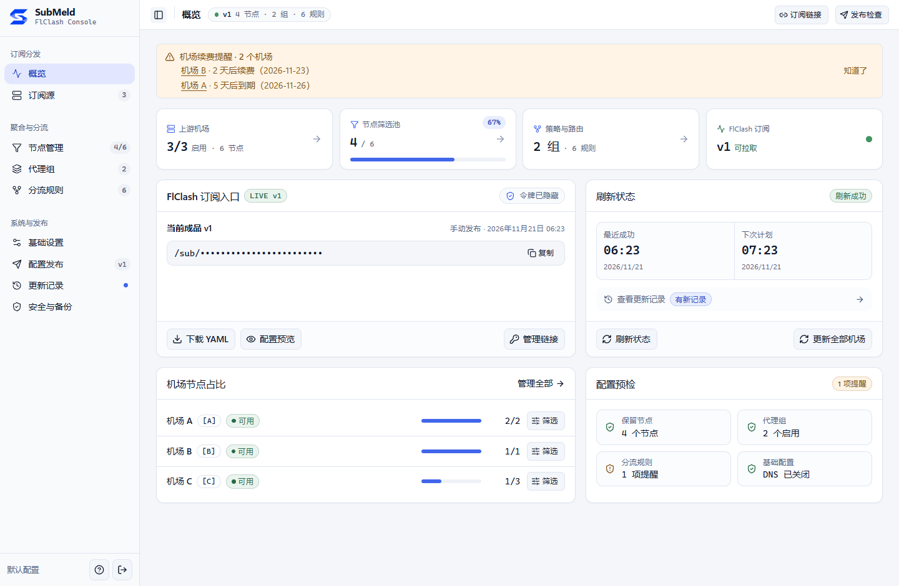

<p align="center">
  <a href="docs/assets/submeld-logo.svg"></a>
</p>

<p align="center">
  <strong>把多个订阅源合并为一条私有订阅。</strong><br>
  在自己的服务器上筛选节点、编排路由规则，用 Mihomo 校验并发布配置。
</p>

<p align="center">
  
  <a href="https://github.com/MetaCubeX/mihomo/releases/tag/v1.19.34"></a>
  
</p>

<p align="center">
  <a href="#快速开始">快速开始</a> ·
  <a href="#订阅与分流">订阅与分流</a> ·
  <a href="#刷新与续费">刷新与续费</a> ·
  <a href="#部署与备份">部署</a> ·
  <a href="#文档">文档</a>
</p>

- **按订阅源筛选节点。** 可以保留主订阅源的全部节点，同时只取备用订阅源的香港节点。遇到重名时，为其中一个订阅源设置节点名称前缀即可区分。
- **按服务选择出站策略。** 让 GitHub 走「开发」组、Gemini 走「AI」组。输入域名，就能预览命中的规则和出站策略。
- **在同一地址更新配置。** 工作台定时拉取上游。更新通过检查后，同一订阅链接将提供新配置，也可以在工作台回滚到历史版本。
- **一起管理流量与续费。** 订阅源卡片显示剩余流量和到期日，概览按日期列出即将续费的订阅源。

<details>
<summary>查看工作台示例 · 3 个订阅源共 6 个节点，筛选后保留 4 个</summary>



</details>

## 快速开始

### 1. 启动工作台

需要 **Node.js 24 或以上**。在项目根目录运行以下命令。

```sh
npm ci
npm run core:install
npm run build
npm start
```

安装脚本支持 Windows、Linux 和 macOS 的 x64 与 ARM64，会下载固定版本的 Mihomo 并核对 SHA-256。Windows 解压时使用系统自带的 `tar.exe`。已有 Mihomo 时，可跳过 `npm run core:install`，将 `SUBMELD_MIHOMO_BIN` 设为可执行文件的绝对路径。

服务启动后，在服务端本机打开工作台并创建管理密码。[打开本机工作台](http://127.0.0.1:8787)

### 2. 添加订阅源并筛选节点

在「订阅源」点「添加订阅源」，填写名称，选择导入方式。

- **订阅链接**接受 HTTP(S) 上游订阅地址，点「测试并预览」获取节点。
- **YAML 配置**可粘贴 Mihomo / Clash 配置或选择 `.yaml`、`.yml` 文件，支持 `proxies` 和顶层节点数组。
- **节点链接**可逐行粘贴分享链接，也支持整份 Base64 编码的链接列表。粘贴的链接缺少名称时，使用服务器地址和端口作为节点名。

YAML 和节点链接导入为本地订阅源，点「解析并预览」即可筛选。例如，要让备用订阅源只提供香港节点，在「仅保留地区」选择香港，再按需排除「试用」等关键词。核对保留数量和无法导入的条目后，点「保存订阅源」。

### 3. 配置代理组并发布订阅

1. 在「代理组」点「新建代理组」，例如命名为「开发」。用「动态筛选」选入刚添加的订阅源，或直接点选节点。
2. 在「路由规则」点「添加规则集」，搜索 GitHub，选择 `geosite/github`，将出站策略设为「开发」。
3. 在「配置发布」点「运行检查」，通过后点「发布配置」。复制私有订阅链接，即可在兼容 Mihomo 配置的客户端中订阅。其他设备需要能访问该链接所用的主机地址。

需要为不同用途分别发布订阅时，点侧栏底部的「配置方案」，可新建空白方案、复制当前配置和节点，或切换到已有方案。每个方案独立设置节点筛选、代理组和路由规则，发布后有自己的私有订阅链接。

要按地区自动选择节点，在「代理组」点「地区自动选择」，勾选香港、日本、新加坡或美国后导入。每个所选地区生成一个独立的 `url-test` 组。默认勾选已有保留节点的地区，订阅更新时会重新匹配组内节点。

## 订阅与分流

| 配置项 | 支持的内容 | 使用方式 |
| --- | --- | --- |
| 订阅源 | 含 `proxies` 的 Mihomo / Clash YAML、节点 YAML 列表、明文或 Base64 编码的分享链接列表 | 订阅链接按计划刷新。直接导入的内容随方案保存，参与筛选和发布。外部代理集合会在预览中标出。 |
| 节点筛选 | 来源、地区、关键词和手动排除 | 地区按节点原名推断。可在节点原名前加上前缀，成品保留连接所需的认证和传输参数。 |
| 代理组 | 手动选择、自动选择、自动回退、负载均衡 | 组内代理可以是节点、其他代理组或内置策略。生成配置时，动态筛选按所在位置展开为节点，代理列表按顺序去重。 |
| 路由规则 | MetaCubeX GeoSite / GeoIP 规则集、自定义 YAML 或文本规则集、手动规则 | 按列表顺序匹配。目录中的 MRS 规则集由客户端每 24 小时更新，自定义远程规则集由服务端拉取后内嵌。 |

分享链接支持 SS、SSR、VMess、VLESS、Trojan、Hysteria2、SOCKS5 和 AnyTLS，具体连接参数以导入预览为准。代理组的动态筛选支持 RE2 正则，按带前缀的节点名匹配，默认忽略大小写。例如，包含 `IEPL|专线`、排除 `测试|过期`，即可在代理列表预览中核对匹配结果。

域名测试会按优先级检查规则。遇到 GeoSite 时，服务端按需读取官方域名列表。需要解析 IP、依赖客户端环境或规则列表暂不可用时，结果会标明不确定。[Mihomo 规则说明](https://wiki.metacubex.one/config/rules/)

## 刷新与续费

**刷新沿用已发布的配置。** 调整更新间隔或暂停定时刷新会立即影响调度。更换订阅源地址、移除来源、调整筛选或规则后，再次发布才会切换客户端可拉取的内容。

**异常更新保留上一版。** 上游获取失败、返回空列表、节点重名或 Mihomo 校验失败时，当前订阅继续可用，原因记在「更新记录」。可导入节点或保留节点减少超过一半，或保留数降至零时，可到「订阅源」核对候选结果，采纳后再发布。需要恢复旧配置时，在「配置发布」选择历史版本回滚。下一次手动发布会恢复成品的自动更新。

**续费提醒默认提前 7 天。** 订阅源卡片从订阅源的 `Subscription-Userinfo` 响应头读取流量额度和到期日，并标出最近获取时间。剩余流量按总额度减去上传量和下载量计算，最低显示为零。点击「设置日期」可手填续费日，留空时采用订阅到期日。从提前 7 天到当天，同一方案内每个订阅源的同一日期只在概览提醒一次。[订阅用量响应头说明](https://github.com/alireza0/s-ui/wiki/Subscription-Service)

## 部署与备份

在持续运行的主机上启动 SubMeld，关闭浏览器后服务端仍会按计划刷新。公网部署时，用 HTTPS 反向代理转发请求，保留访问域名的 `Host`，并将 `SUBMELD_PUBLIC_URL` 设为客户端可访问的 HTTPS 源。私有订阅链接可用于获取节点配置，反向代理日志应遮挡 `/sub/` 后的令牌。

| 环境变量 | 默认值 | 用途 |
| --- | --- | --- |
| `SUBMELD_HOST` | `127.0.0.1` | 服务监听地址 |
| `SUBMELD_PORT` | `8787` | 服务监听端口 |
| `SUBMELD_DATA_DIR` | `./data` | SQLite 数据、Mihomo 校验目录及地理数据 |
| `SUBMELD_MIHOMO_BIN` | `./bin/mihomo`，Windows 为 `./bin/mihomo.exe` | 指定校验核心的绝对路径 |
| `SUBMELD_ADMIN_PASSWORD` | 在本机首次设置 | 无人值守部署的初始管理密码，设置完成后可移除该变量 |
| `SUBMELD_PUBLIC_URL` | 当前访问源 | 生成私有链接使用的公开源，例如 `https://sub.example.com` |
| `SUBMELD_SECURE_COOKIES` | 公开源为 HTTPS 时启用 | 设为 `1` 可显式启用 Secure Cookie |
| `SUBMELD_ALLOW_PRIVATE_UPSTREAMS` | 关闭 | 在受信任的私有环境设为 `1`，允许获取内网订阅和规则集 |

每个数据目录运行一个实例。数据目录和成品 YAML 包含节点凭证，应限制访问权限。发布检查会拦截成品中的完整上游订阅地址，以及出现在名称、前缀 或规则等字段中的下载令牌。

在「安全与备份」可撤销私有链接，或用口令导出加密备份。恢复备份会替换配置方案、历史版本和节点缓存，并撤销原有订阅链接。恢复后用当前管理密码登录，生成新链接并在客户端替换。

## 常用命令

| 命令 | 用途 |
| --- | --- |
| `npm run dev` | 启动 Vite 开发服务器、工作台 API 和刷新调度，支持 React 热更新 |
| `npm run typecheck` | 严格检查前端、服务端、共享逻辑、脚本和测试的 TypeScript 类型 |
| `npm run core:install` | 安装或检查项目指定版本的 Mihomo |
| `npm run build` | 通过类型检查后，将生产管理界面构建到 `dist/` |
| `npm start` | 启动工作台、私有订阅接口和刷新调度 |
| `npm test` | 运行单元测试与 HTTP 集成测试 |
| `npm run test:ui` | 运行 Chromium 浏览器端到端测试 |
| `node scripts/update-rule-sets.ts` | 更新内置规则集索引，随后重新构建管理界面 |

## 文档

| 想了解什么 | 去哪里 |
| --- | --- |
| SubMeld 面向谁，如何管理订阅 | [产品定位](PRODUCT.md) |
| 使用场景、功能范围和验收标准 | [产品需求说明](SubMeld_REQUIREMENTS%20%282%29.md) |
| 工作台布局、颜色和组件约定 | [界面设计规范](DESIGN.md) |
| 下载 SubMeld 标志 | [SVG 矢量版](docs/assets/submeld-logo.svg) · [透明 PNG](docs/assets/submeld-logo.png) |
| 代理组与内置策略 | [Clash 出站手册存档](https://github.com/BackupTime/clash/blob/master/docs/zh_CN/configuration/outbound.md) · [Mihomo 代理组](https://wiki.metacubex.one/config/proxy-groups/) · [内置代理策略](https://wiki.metacubex.one/config/proxies/built-in/) |
| 内置 GeoSite 与 GeoIP 规则集的来源 | [MetaCubeX 规则集目录](https://github.com/MetaCubeX/meta-rules-dat/tree/meta/geo) |

## 开发与验证

前端采用 React、Vite 和 TypeScript，服务端由 Node.js 24 直接运行 TypeScript。安装依赖和 Mihomo 后，运行 `npm run dev`，打开终端显示的本机地址（默认 `http://127.0.0.1:5173`）。页面、`/api/` 和 `/sub/` 共用该地址。开发时可用 `SUBMELD_DATA_DIR` 指定独立的数据目录。

浏览器测试会启动生产服务并读取 `dist/`。运行以下命令可验证类型、构建、服务端和浏览器流程。

```sh
npm run build
npm test
npx playwright install chromium
npm run test:ui
```

将 `SUBMELD_MIHOMO_BIN` 设为核心的绝对路径后，HTTP 集成用例也会调用真实 Mihomo。浏览器测试使用三个合成订阅源，覆盖节点筛选、规则命中、发布下载、续费提醒与窄屏操作。已有 Chromium 或 Chrome 时，可用 `PLAYWRIGHT_CHROMIUM_EXECUTABLE` 指定路径。
